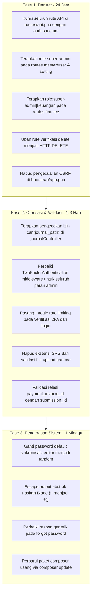

# Laporan Lengkap Audit Keamanan & Panduan Perbaikan (Security Audit & Remediation Guide)
**Aplikasi**: Platform Rumah Jurnal  
**Framework**: Laravel 11.x | PHP 8.3 | Spatie Laravel Permission  
**Tanggal Audit**: 17 November 2026  
**Metodologi**: Analisis Statis Kode Sumber (SAST), Audit Alur Data (Data Flow Tracing), Evaluasi OWASP Top 10:2021, dan Pemindaian Dependensi Composer.

---

## Ringkasan Eksekutif (Executive Summary)

Audit keamanan menyeluruh telah dilakukan pada seluruh repositori kode sumber **Rumah Jurnal**. Hasil audit menemukan **16 kerentanan keamanan** dengan distribusi tingkat keparahan sebagai berikut:

- 🔴 **Kritis (Critical)**: 4 Temuan
- 🟠 **Tinggi (High)**: 3 Temuan
- 🟡 **Menengah (Medium)**: 5 Temuan
- 🔵 **Rendah / Informasi (Low/Info)**: 4 Temuan

### Matriks Daftar Temuan (Vulnerability Matrix)

| ID | Kerentanan | Kategori OWASP | Tingkat Keparahan | Lokasi Utama |
| :--- | :--- | :--- | :---: | :--- |
| **SEC-01** | Rute API WhatsApp & Jurnal Terbuka Publik (Spam & SSRF) | A01: Broken Access Control & A10: SSRF | 🔴 CRITICAL | `routes/api.php`, `WhatsappController`, `JournalController` |
| **SEC-02** | Broken Access Control & Eskalasi Super-Admin Tanpa Izin | A01: Broken Access Control | 🔴 CRITICAL | `UserController`, `FinanceController`, `SettingController` |
| **SEC-03** | Horizontal Privilege Escalation Masif pada Modul Jurnal | A01: Broken Access Control | 🔴 CRITICAL | `journalController.php`, `routes/web.php` |
| **SEC-04** | Penghapusan Data Pembayaran Menggunakan Metode HTTP GET | A01: Broken Access Control & A04: Insecure Design | 🔴 CRITICAL | `routes/web.php:345`, `FinanceController:383` |
| **SEC-05** | Pengecualian Validasi CSRF Token pada Rute Sensitif | A01: Broken Access Control (CSRF) | 🟠 HIGH | `bootstrap/app.php:22-26` |
| **SEC-06** | Celah Bypass 2FA & Kerentanan Brute Force OTP | A07: Identification & Auth Failures | 🟠 HIGH | `TwoFactorAuthentication`, `TwoFactorController`, `GoogleController` |
| **SEC-07** | Potensi Stored XSS via Unggahan Gambar Berkas SVG | A03: Injection (XSS) | 🟠 HIGH | `MenuProfilController:115`, `MasterdataController:51` |
| **SEC-08** | Ketiadaan Rate Limiting pada Rute Autentikasi Sensitif | A07: Identification & Auth Failures | 🟡 MEDIUM | `routes/web.php:50-71` |
| **SEC-09** | Unescaped Raw Output `{!!` pada Abstrak Naskah OJS | A03: Injection (Stored XSS) | 🟡 MEDIUM | `modal-view-article.blade.php:87`, `submission.blade.php:163` |
| **SEC-10** | Password Lemah Default `'rumahjurnal123'` pada Sinkronisasi Editor | A07: Identification & Auth Failures | 🟡 MEDIUM | `MasterdataController:392` |
| **SEC-11** | Penonaktifan Verifikasi SSL Peer pada Koneksi Outbound | A02: Cryptographic Failures | 🟡 MEDIUM | `journalController.php:1395` |
| **SEC-12** | IDOR pada Pengunduhan Sertifikat Peserta Event | A01: Broken Access Control | 🟡 MEDIUM | `EventController.php:178` |
| **SEC-13** | Kunci Rahasia Default WhatsApp Bocor di `.env.example` | A05: Security Misconfiguration | 🔵 LOW | `.env.example:74-75` |
| **SEC-14** | User Enumeration pada Fitur Lupa Password | A07: Identification & Auth Failures | 🔵 LOW | `ForgotPasswordController:47` |
| **SEC-15** | Rute Publik Eksekusi Perintah Artisan `generate-storage` | A05: Security Misconfiguration | 🔵 LOW | `routes/web.php:37-40` |
| **SEC-16** | Paket Dependensi Lama dengan Kerentanan Terpublikasi | A06: Vulnerable & Outdated Components | 🔵 LOW | `composer.lock` (`dompdf/dompdf`, dll.) |

---

## 1. Temuan Kritis (Critical Severity)

### SEC-01: Rute API WhatsApp & Sinkronisasi Jurnal Terbuka Publik (Spam, Pembajakan Sesi & SSRF)
- **File Terdampak**:
  - `routes/api.php` (Baris 11–65)
  - `app/Http/Controllers/Api/WhatsappController.php` (Baris 224–260)
  - `app/Http/Controllers/Api/JournalController.php` (Baris 18–70, 173–222)
- **Deskripsi & Analisis Risiko**:
  1. Seluruh grup rute `v1`, `whatsapp-api`, dan `chatery-whatsapp-api` di `routes/api.php` tidak memiliki middleware autentikasi apa pun.
  2. Siapa pun dapat mengirim request HTTP POST ke `/api/whatsapp-api/send-message` atau `/api/whatsapp-api/send-bulk-message` dengan payload sembarang (`phone` dan `message`). Server akan mengirim pesan tersebut langsung menggunakan nomor WhatsApp resmi institusi, berisiko tinggi dipakai penyerang untuk spam atau phishing massal.
  3. Penyerang dapat memutuskan sesi WhatsApp resmi via `/api/whatsapp-api/delete-session`.
  4. Endpoint `/api/v1/journal/store` menerima input parameter `$request->url` tanpa validasi whitelist, lalu server melakukan request:
     ```php
     $response = Http::retry(3, 100)->timeout(120)->withHeaders([...])->get($url . '/api/v1/contexts', ...);
     ```
     Ini adalah celah **Server-Side Request Forgery (SSRF)**. Penyerang dapat memasukkan alamat IP lokal/privat (misalnya `http://127.0.0.1:6379`, `http://169.254.169.254/latest/meta-data/` pada cloud VPS, atau port internal kampus) untuk memindai port dan mengekstrak data dari layanan internal.
  5. Endpoint `/api/v1/submissions/list` dapat di-query tanpa login, mengekspos judul artikel yang belum dipublikasi, nama penulis, dan abstrak ke publik.
- **Rekomendasi Perbaikan**:
  1. Lindungi grup rute `routes/api.php` dengan token autentikasi (Sanctum atau token statis aman).
  2. Validasi URL jurnal agar hanya menggunakan HTTPS dan menolak alamat IP privat/lokal.

```php
// routes/api.php
Route::prefix('v1')->middleware(['auth:sanctum'])->name('api.v1.')->group(function () {
    // Rute API terproteksi
});

Route::prefix('whatsapp-api')->middleware(['auth:sanctum'])->name('api.whatsapp.')->group(function () {
    // Rute WhatsApp terproteksi
});
```

---

### SEC-02: Broken Access Control & Eskalasi Hak Akses ke Super-Admin pada Modul User, Finance, dan Setting
- **File Terdampak**:
  - `app/Http/Controllers/Back/UserController.php` (Baris 58–125)
  - `app/Http/Controllers/Back/FinanceController.php` (Baris 37–44)
  - `app/Http/Controllers/Back/SettingController.php` (Baris 16–70)
  - `routes/web.php` (Baris 340–425)
- **Deskripsi & Analisis Risiko**:
  1. Pada `UserController.php`, method `create()`, `store()`, `edit()`, `update()`, dan `destroy()` tidak memiliki proteksi otorisasi peran (*role check*).
  2. Pengguna level apa pun yang memiliki akses ke panel belakang (misal `editor` atau `humas`) dapat langsung mengakses formulir pembuatan user `/back/master/user/create` dan mengirim request dengan payload `role_super_admin=1`. Kode controller akan mengeksekusi:
     ```php
     if ($request->role_super_admin) {
         $user->assignRole('super-admin');
     }
     ```
     Ini memungkinkan eskalasi hak akses vertikal penuh menjadi **Super-Admin**.
  3. Pada `FinanceController.php`, satu-satunya pengecekan di constructor adalah:
     ```php
     $this->cookie_control_panel = Cookie::get('control_panel');
     if (!$this->cookie_control_panel) {
         redirect()->route('back.dashboard')->send();
     }
     ```
     Karena cookie ini dapat diset oleh pengguna mana pun dengan mengakses `/back/switch-control/journal`, siapa pun yang login dapat menyetujui/menolak pembayaran (`verificationUpdate`), melihat seluruh laporan keuangan institusi, dan menambah/menghapus arus kas (`cashflow`).
  4. Pada `SettingController.php`, tidak ada pengecekan peran super-admin, sehingga editor biasa dapat mengganti judul situs, email sistem, konfigurasi bot, dan rekening pembayaran.
- **Rekomendasi Perbaikan**:
  Terapkan middleware peran Spatie langsung pada grup rute di `routes/web.php`:

```php
// routes/web.php
Route::prefix('master/user')->middleware(['role:super-admin'])->name('master.user.')->group(function () {
    Route::get('/', [BackUserController::class, 'index'])->name('index');
    Route::get('/create', [BackUserController::class, 'create'])->name('create');
    Route::post('/create', [BackUserController::class, 'store'])->name('store');
    Route::get('/edit/{id}', [BackUserController::class, 'edit'])->name('edit');
    Route::put('/edit/{id}', [BackUserController::class, 'update'])->name('update');
    Route::delete('/delete/{id}', [BackUserController::class, 'destroy'])->name('destroy');
});

Route::prefix('finance')->middleware(['role:super-admin|keuangan'])->name('finance.')->group(function () {
    // Seluruh rute keuangan
});

Route::prefix('setting')->middleware(['role:super-admin'])->name('setting.')->group(function () {
    // Seluruh rute setting
});
```

---

### SEC-03: Horizontal Broken Access Control & IDOR Masif pada Modul Jurnal (Multi-Tenancy Flaw)
- **File Terdampak**:
  - `app/Http/Controllers/Back/journalController.php`
  - `routes/web.php` (Baris 270–340)
- **Deskripsi & Analisis Risiko**:
  1. Sistem mengalokasikan hak akses per jurnal kepada editor menggunakan nama permission yang sama dengan `url_path` jurnal (`$user->can($journal->url_path)`).
  2. Namun pemeriksaan otorisasi `abort_unless(auth()->user()->can($journal->url_path), 403)` **hanya ada di 2 method** (yaitu `index` dan `searchAuthor`).
  3. Puluhan method krusial lainnya sama sekali tidak mengecek izin akses jurnal:
     - Mengubah/memindahkan naskah: `articleUpdate`, `articleMoveIssue`
     - Mengelola edisi/issue: `issueStore`, `issueUpdate`, `issueDestroy`
     - Mengelola tim: `editorIndex`, `editorUpdate`, `editorDestroy`, `reviewerIndex`, `reviewerDestroy`
     - Mengelola pengaturan: `settingIndex`, `settingUpdate`, `loaTemplateUpload`
     - Finansial naskah: `invoiceCustomStore`, `invoiceDestroy`, `loaGenerate`, `invoiceGenerate1`
  4. Akibatnya, seorang editor yang hanya memiliki hak akses untuk `jurnal-a` dapat langsung menembak URL `/back/jurnal-b/issue/1/article` untuk membaca naskah jurnal lain, memindahkan naskah, mengubah data naskah, bahkan menghapus invoice dan riwayat pembayaran jurnal lain via `/invoice/{invoice_id}/destroy`.
- **Rekomendasi Perbaikan**:
  Buat middleware atau method helper verifikasi akses jurnal yang dipanggil secara konsisten di setiap method:

```php
private function authorizeJournalAccess(string $journalPath): Journal
{
    $journal = Journal::where('url_path', $journalPath)->firstOrFail();
    if (!auth()->user()->hasRole('super-admin') && !auth()->user()->can($journal->url_path)) {
        abort(403, 'Anda tidak memiliki hak akses untuk jurnal ini.');
    }
    return $journal;
}
```

---

### SEC-04: Penghapusan Data Finansial Kritis Menggunakan Metode HTTP GET (CSRF-Immune)
- **File Terdampak**:
  - `routes/web.php` (Baris 345)
  - `app/Http/Controllers/Back/FinanceController.php` (Baris 383–403)
- **Deskripsi & Analisis Risiko**:
  1. Rute pembatalan/penghapusan verifikasi pembayaran didefinisikan menggunakan metode HTTP `GET`:
     ```php
     Route::get('/verification/{id}/delete', [BackFinanceController::class, 'verificationDelete'])->name('verification.delete');
     ```
  2. Karena rute ini bertipe `GET`, Laravel tidak melakukan validasi CSRF token.
  3. Penyerang dapat menyematkan tag gambar sederhana pada situs web lain:
     ``
     Jika seorang staf/admin yang sedang login membuka halaman web tersebut, pembayaran ID 105 akan langsung terhapus dari basis data tanpa konfirmasi.
  4. Fitur *link prefetching* pada browser modern atau perayap bot juga dapat mengeksekusi penghapusan data secara tidak sengaja.
- **Rekomendasi Perbaikan**:
  Ubah rute menjadi `DELETE`:

```php
// routes/web.php
Route::delete('/verification/{id}', [BackFinanceController::class, 'verificationDelete'])->name('verification.delete');
```
Dan perbarui tombol hapus pada view Blade agar mengirim form dengan `@csrf` dan `@method('DELETE')`.

---

## 2. Temuan Tingkat Tinggi (High Severity)

### SEC-05: Pengecualian Validasi CSRF Token pada Rute Sensitif
- **File Terdampak**: `bootstrap/app.php` (Baris 22–26)
- **Kode Rentan**:
  ```php
  $middleware->validateCsrfTokens(except: [
      '/login',
      '/register',
      '/back/menu/profil/upload'
  ]);
  ```
- **Deskripsi & Analisis Risiko**:
  1. **Login CSRF**: Pengecualian `/login` memungkinkan penyerang membuat halaman yang secara otomatis mengirimkan form login dengan kredensial penyerang ke browser korban. Korban akan tanpa sadar masuk ke akun penyerang. Jika korban kemudian mengunggah naskah atau melakukan pembayaran, seluruh data tersebut tersimpan di akun penyerang.
  2. **Register CSRF**: Mengizinkan penyerang mendaftarkan akun secara otomatis melalui browser korban tanpa persetujuan korban.
  3. **Arbitrary Upload CSRF**: `/back/menu/profil/upload` adalah rute pengunggahan file ke storage publik. Tanpa CSRF, situs eksternal dapat memicu pengunggahan file sembarangan menggunakan sesi aktif admin.
- **Rekomendasi Perbaikan**:
  Hapus ketiga rute tersebut dari daftar pengecualian di `bootstrap/app.php`. Pastikan form web menyertakan `@csrf` dan editor teks (CKEditor/Summernote) menyertakan header `X-CSRF-TOKEN`.

---

### SEC-06: Celah Bypass Autentikasi Dua Faktor (2FA) & Kerentanan Brute Force OTP
- **File Terdampak**:
  - `app/Http/Middleware/TwoFactorAuthentication.php` (Baris 26–33)
  - `app/Http/Controllers/Auth/GoogleController.php` (Baris 39–45)
  - `app/Http/Controllers/Auth/TwoFactorController.php` (Baris 191–240)
  - `routes/web.php` (Baris 55–62)
- **Deskripsi & Analisis Risiko**:
  1. **Role Mismatch**: Middleware `TwoFactorAuthentication` hanya mengecek string:
     `$user->hasRole('super-admin|keuangan|editor|humas')`.
     Peran administratif yang baru seperti `admin-ejournal`, `admin-proceeding`, `admin-student-research-hub`, `editor-proceeding`, dan `editor-student-research-hub` **tidak terdaftar**, sehingga mereka dapat mengakses dashboard tanpa verifikasi 2FA sama sekali.
  2. **Google OAuth Issue**: `GoogleController::callback()` melakukan login via `Auth::login($user)` tanpa mengatur `session(['2fa:verified' => true])` dan tanpa mengarahkan ke form verifikasi 2FA, menyebabkan sesi admin langsung ditolak dan di-logout oleh middleware.
  3. **Brute Force OTP**: Endpoint `POST /2fa/verify` tidak memiliki rate limiting (`throttle`). Selain itu, di method `verify()` tidak ada pembatasan jumlah percobaan gagal (misal 3 atau 5 kali salah langsung meng-invalidasi kode). Penyerang dapat melakukan brute-force 6 digit OTP (000000–999999) dalam jendela waktu aktif kode.
- **Rekomendasi Perbaikan**:
  1. Ubah pemeriksaan role menjadi:
     ```php
     if ($user && $user->roles()->exists()) {
         if (!session('2fa:verified')) {
             Auth::logout();
             return redirect()->route('login')->with('error', 'Silakan verifikasi 2FA terlebih dahulu.');
         }
     }
     ```
  2. Tambahkan `middleware('throttle:5,1')` pada rute `POST /2fa/verify`.
  3. Tambahkan kolom `attempts` pada tabel `two_factor_codes` dan hanguskan kode jika salah 3 kali berturut-turut.

---

### SEC-07: Potensi Stored Cross-Site Scripting (XSS) via Upload Berkas Gambar SVG
- **File Terdampak**:
  - `app/Http/Controllers/Back/MenuProfilController.php` (Baris 115–135)
  - `app/Http/Controllers/Back/MasterdataController.php` (Baris 51)
- **Deskripsi & Analisis Risiko**:
  1. Aturan validasi mengizinkan ekstensi `svg` (`mimes:jpeg,png,jpg,gif,svg`).
  2. Format berkas SVG berbasis XML dan dapat menyematkan script JavaScript aktif (misal `<svg onload="alert(document.cookie)"></svg>`).
  3. Berkas disimpan di disk publik (`public`) dan dapat diakses langsung via URL browser. Jika diakses oleh admin lain atau pengunjung situs, script JavaScript akan dieksekusi dalam konteks domain aplikasi (Stored XSS), berpotensi mencuri session cookie atau melakukan aksi atas nama admin.
  4. Penggunaan `$file->getClientOriginalExtension()` membaca ekstensi dari header klien, bukan dari pemeriksaan MIME type riil di server.
- **Rekomendasi Perbaikan**:
  1. Hapus `svg` dari daftar format gambar yang diizinkan untuk upload umum: `mimes:jpeg,png,jpg,webp`.
  2. Gunakan `$file->guessExtension()` atau `$file->extension()`.

---

## 3. Temuan Tingkat Menengah (Medium Severity)

### SEC-08: Ketiadaan Rate Limiting pada Endpoint Autentikasi Sensitif
- **File Terdampak**: `routes/web.php` (Baris 50–71)
- **Deskripsi**:
  Rute `POST /login`, `POST /register`, `POST /forgot-password`, dan `POST /reset-password` tidak memiliki middleware pembatas laju (`throttle`). Penyerang dapat melakukan brute-force password (credential stuffing), spam pendaftaran akun, atau email bombing via reset password.
- **Rekomendasi Perbaikan**:
  Tambahkan rate limiting:
  ```php
  Route::post('/login', [LoginController::class, 'login'])->name('login.post')->middleware(['TrustProxies', 'throttle:5,1']);
  Route::post('/forgot-password', [ForgotPasswordController::class, 'sendResetLinkEmail'])->name('password.email')->middleware('throttle:3,1');
  ```

---

### SEC-09: Unescaped Raw Output `{!!` pada Abstrak Naskah OJS (Stored XSS)
- **File Terdampak**:
  - `resources/views/back/pages/journal/modal-view-article.blade.php` (Baris 87)
  - `resources/views/front/pages/payment/submission.blade.php` (Baris 163)
- **Deskripsi**:
  Data `$submission->abstract` dirender langsung tanpa escape HTML: `<td>{!! $submission->abstract !!}</td>`. Jika naskah yang disinkronisasi dari OJS atau diinput penulis mengandung tag HTML/JavaScript berbahaya, script akan terpicu ketika editor/admin membuka modal rincian artikel.
- **Rekomendasi Perbaikan**:
  Gunakan fungsi escape bawaan Laravel:
  ```blade
  <td>{!! nl2br(e($submission->abstract)) !!}</td>
  ```

---

### SEC-10: Password Lemah Default Hardcoded `'rumahjurnal123'` pada Sinkronisasi Editor
- **File Terdampak**: `app/Http/Controllers/Back/MasterdataController.php` (Baris 392)
- **Deskripsi**:
  Saat sinkronisasi data editor dari OJS ke tabel `users`, akun baru otomatis diberi password `'rumahjurnal123'`:
  ```php
  $user->password = bcrypt('rumahjurnal123');
  ```
  Siapa pun yang mengetahui alamat email editor yang terdaftar di OJS dapat langsung login ke portal Rumah Jurnal menggunakan password default ini.
- **Rekomendasi Perbaikan**:
  Generate password acak yang kuat (`Str::random(16)`), simpan hash-nya, dan kirimkan email tautan setel ulang password (reset password link) kepada editor terkait.

---

### SEC-11: Penonaktifan Verifikasi SSL Peer pada Koneksi Outbound
- **File Terdampak**: `app/Http/Controllers/Back/journalController.php` (Baris 1395–1396)
- **Deskripsi**:
  Saat mengambil thumbnail jurnal dari URL eksternal, kode sengaja mematikan verifikasi SSL:
  ```php
  'ssl' => [
      'verify_peer' => false,
      'verify_peer_name' => false,
  ]
  ```
  Hal ini membuat koneksi outbound rentan terhadap serangan Man-in-the-Middle (MitM) jika jaringan lokal disadap atau terjadi DNS spoofing.
- **Rekomendasi Perbaikan**:
  Aktifkan kembali verifikasi SSL (`'verify_peer' => true, 'verify_peer_name' => true`) dan pastikan server host memiliki paket CA bundle sertifikat SSL yang valid.

---

### SEC-12: Insecure Direct Object Reference (IDOR) pada Unduh Sertifikat Event
- **File Terdampak**: `app/Http/Controllers/Front/EventController.php` (Baris 178–185)
- **Deskripsi**:
  Method `certificate($uuid)` mengambil `$eventUser = EventUser::find($uuid)` tanpa memeriksa apakah pengguna yang login adalah pemilik sertifikat tersebut. Pengguna mana pun dapat mengunduh sertifikat milik peserta lain hanya dengan mengetahui atau menebak UUID event user.
- **Rekomendasi Perbaikan**:
  Tambahkan validasi kepemilikan:
  ```php
  if ($eventUser->user_id !== Auth::id() && !Auth::user()->hasRole('super-admin')) {
      abort(403, 'Anda tidak memiliki hak untuk mengunduh sertifikat ini.');
  }
  ```

---

## 4. Temuan Rendah & Informasi Praktik Terbaik (Low & Informational)

### SEC-13: Kunci Rahasia Default WhatsApp Bocor di `.env.example`
- **File Terdampak**: `.env.example` (Baris 74–75)
- **Deskripsi**: Nilai secret default `WHATSAPP_API_SECRET=CreateByGariskodeTechnology` tercatat pada template repositori publik. Jika tim deploy menyalin `.env.example` ke `.env` produksi tanpa mengganti rahasia ini, pihak luar dapat menebak kunci API tersebut.
- **Rekomendasi**: Kosongkan nilai default pada template: `WHATSAPP_API_SECRET=`.

### SEC-14: User Enumeration pada Fitur Lupa Password
- **File Terdampak**: `app/Http/Controllers/Auth/ForgotPasswordController.php` (Baris 47)
- **Deskripsi**: Pesan validasi `email.exists => 'Email tidak ditemukan dalam sistem kami'` memberitahu penyerang secara pasti apakah sebuah alamat email terdaftar di sistem atau tidak.
- **Rekomendasi**: Selalu tampilkan pesan generik: *"Jika alamat email terdaftar di sistem kami, tautan reset password telah dikirimkan ke kotak masuk Anda."*

### SEC-15: Rute Publik Eksekusi Perintah Artisan `generate-storage`
- **File Terdampak**: `routes/web.php` (Baris 37–40)
- **Deskripsi**: Rute `GET /generate-storage` menjalankan `Artisan::call('storage:link')` tanpa autentikasi.
- **Rekomendasi**: Hapus rute ini dari file web routes dan jalankan symlink melalui terminal CLI server.

### SEC-16: Dependensi Paket dengan Advisori Keamanan (`composer audit`)
- **File Terdampak**: `composer.lock`
- **Deskripsi**: `composer audit` mendeteksi advisori keamanan pada versi lama paket pihak ketiga (seperti `dompdf/dompdf` terkait parsing berkas gambar SVG/BMP).
- **Rekomendasi**: Jalankan `composer update barryvdh/laravel-dompdf dompdf/dompdf` secara berkala setelah melakukan pengujian regresi.

---

## 5. Rencana Tindakan Berdasarkan Prioritas (Action Plan)



---
*Dokumen ini disusun sebagai acuan resmi penguatan keamanan sistem Rumah Jurnal.*
